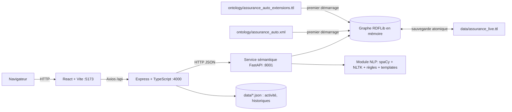
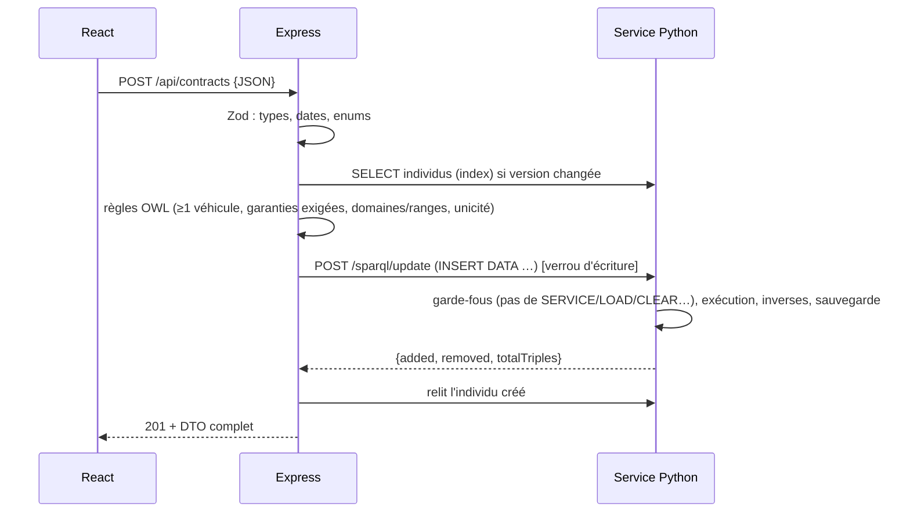

# Architecture technique

## Vue d'ensemble

| Composant | Responsabilité | Ne fait PAS |
|---|---|---|
| **React** | UI, formulaires, graphiques, ontographe ; appelle uniquement l'API Express | accéder au graphe |
| **Express** | Validation (Zod), règles métier issues des axiomes OWL, génération de SPARQL Update sûr, intégrité référentielle, historiques | stocker des données métier |
| **Service Python** | Seul détenteur du graphe : SPARQL query/update, introspection OWL, validation structurelle, NLP | exposer l'UI |

## Pourquoi cette découpe

- Le sujet impose Express/TypeScript pour l'API et recommande Python (spaCy, RDFLib) pour le NLP : le service Python est la couche sémantique ; Express est la passerelle métier.
- Un seul écrivain sur le graphe : le verrou d'écriture d'Express (`withWriteLock`) et le verrou du store (`RLock`) évitent les identifiants dupliqués.
- Remplaçable par Fuseki : seules les deux fonctions `semantic.query/update` (`backend/src/semantic/client.ts`) parlent au triple store pour le CRUD.

## Persistance et reprise

1. Premier démarrage : parse `assurance_auto.xml` + extensions → matérialise `owl:inverseOf` → écrit `data/assurance_live.ttl`.
2. Chaque `INSERT/DELETE` réussi : sauvegarde atomique (`.tmp` + `os.replace`) ; version du store incrémentée (invalide les caches : index d'individus d'Express, gazetteer NLP).
3. Redémarrage : rechargement de `assurance_live.ttl`.
4. `POST /api/ontology/reset` : copie de sauvegarde (`data/backups/`) puis retour à l'état d'origine.
5. Un `UPDATE` invalide est annulé en bloc (rollback du graphe) ; testé.

## Cycle d'une écriture (exemple : créer un contrat)

Toutes les valeurs passent par `iri()`, `str()`, `dec()`, `int()`, `dateTime()` (`backend/src/semantic/sparql.ts`) : identifiants validés par regex, littéraux échappés.

## Sécurité

| Risque | Mesure |
|---|---|
| Injection SPARQL (CRUD) | Constructeur d'Update paramétré, littéraux échappés, identifiants validés ; test avec `"} ; DROP ALL` |
| Injection SPARQL (NLP) | Voir [NLP_PIPELINE.md](NLP_PIPELINE.md#sécurité) |
| Requêtes dangereuses (utilisateur) | `SERVICE` (SSRF) et `LOAD/CLEAR/DROP/CREATE/ADD/MOVE/COPY` refusés (403) ; limite de lignes ; rollback |
| Données invalides | Zod + règles métier → 422 avec erreurs par champ |
| Intégrité | Suppression refusée (409) si encore référencé ; cascade contrôlée (sinistre → dommages, indemnisations, expertises, rapports) |
| Secrets | Aucun ; `.env.example` fournis ; pas de clé LLM |
| CORS | Origine configurée (`CORS_ORIGIN`) |
| Logs | Requêtes HTTP, opérations, erreurs (niveau configurable) |

## Modèle de données exposé (DTO)

Les DTO d'Express (`backend/src/domain/*.ts`) sont reflétés dans `frontend/src/lib/types.ts`. Les URI d'individus sont stables : personnes `PrenomNom` (suffixe numérique en cas d'homonymie), autres `Classe_NNN` (ex. `Contrat_005`, `Dommage_007`), comme dans l'ontologie d'origine.

## Raisonnement

RDFLib n'est pas un raisonneur OWL. Choix : (a) matérialisation de `owl:inverseOf` ; (b) parcours `rdf:type/rdfs:subClassOf*` dans les requêtes ; (c) axiomes de cardinalité **appliqués par l'API** avant écriture et revérifiés par la validation structurelle ; (d) **HermiT** (Java, hors runtime) pour l'inférence complète et la validation : `npm run test:hermit` ; la correspondance entre les réponses de l'application et HermiT est prouvée dans [HERMIT_VALIDATION.md](HERMIT_VALIDATION.md) et [OWL_REASONING_INTEGRATION.md](OWL_REASONING_INTEGRATION.md).

## Performances

Graphe de ~850 triplets : requêtes en 1–150 ms ; chargement spaCy ≈ 2–5 s au démarrage du service ; index d'Express rechargé uniquement quand la version du store change.
